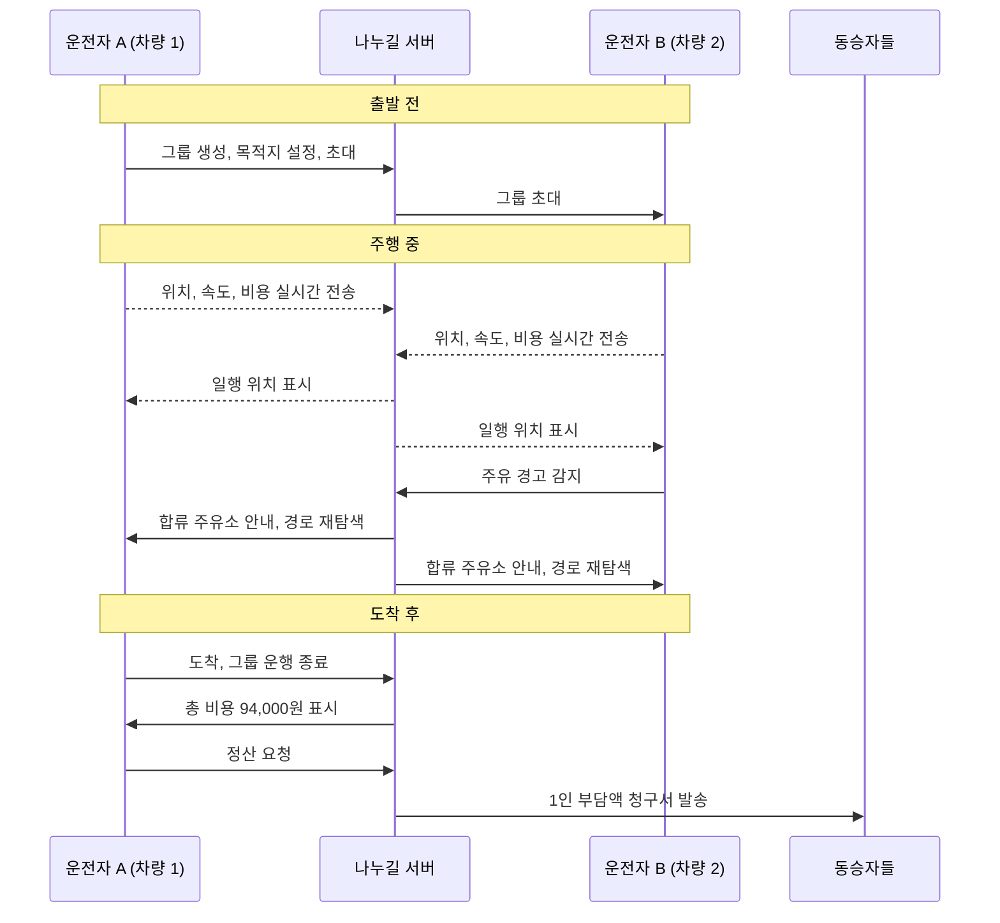
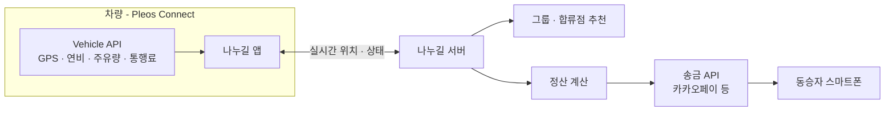

<div align="center">

# 나누길 Nanugil

**같이 달리고, 똑같이 나누는 그룹 주행 앱**

여러 대의 차가 함께 움직일 때 일행의 위치를 차량 화면에 띄워 주고,<br/>
도착하면 그날 쓴 주유비와 통행료를 인원수대로 나눠 정산 요청까지 보내 주는 **Pleos Connect** 차량 앱입니다.


현대자동차그룹 차량용 앱 개발 공모전 2026 출품작

</div>

---

## 목차

1. [한눈에 보기](#한눈에-보기)
2. [왜 만들었나](#왜-만들었나)
3. [왜 차량 앱이어야 하나](#왜-차량-앱이어야-하나)
4. [주요 기능](#주요-기능)
5. [정산은 이렇게 계산합니다](#정산은-이렇게-계산합니다)
6. [사용 시나리오](#사용-시나리오)
7. [화면 구성](#화면-구성)
8. [설계 원칙](#설계-원칙)
9. [기술 스택](#기술-스택)
10. [시스템 구조](#시스템-구조)
11. [프로젝트 구조](#프로젝트-구조)
12. [시작하기](#시작하기)
13. [로드맵](#로드맵)
14. [기대 효과와 확장 계획](#기대-효과와-확장-계획)
15. [개발 기록](#개발-기록)
16. [협업 규칙](#협업-규칙)
17. [팀](#팀)

---

## 한눈에 보기

| 항목 | 내용 |
| --- | --- |
| 앱 이름 | 나누길 (Nanugil) — 길을 *나누고*, 비용을 *나누는* 앱 |
| 플랫폼 | Pleos Connect 차량 인포테인먼트 |
| 핵심 기능 | 그룹 실시간 위치 공유 · 차량 상태 기반 합류점 추천 · 주행 데이터 자동 1/N 정산 |
| 주 사용자 | 대학 MT, 동호회, 가족 여행처럼 차 여러 대로 함께 이동하는 모임 |
| 시연 영상 | 추가 예정 |
| APK | 추가 예정 ([Releases](../../releases)) |

---

## 왜 만들었나

차 두세 대로 MT를 다녀온 적이 있다면 아마 겪어 봤을 겁니다.

**1. 돈 계산이 여행보다 피곤하다.**
여섯 명이 넘으면 보통 차를 나눠 탑니다. 주유는 각자 하고, 톨게이트도 각자 지나갑니다. 돌아와서는 누군가 영수증을 모으고, 하이패스 내역을 뒤지고, 단톡방에 "1인당 얼마"를 올린 다음 송금을 기다립니다. 차마다 낸 돈이 달라서 단순히 나누기 하나로 끝나지도 않습니다.

**2. 일행이 어디쯤 오는지 모른다.**
앞차가 휴게소에 들어갔는지, 뒤차가 얼마나 떨어져 있는지 알려면 결국 전화를 걸거나 메시지를 봐야 합니다. 운전 중에 스마트폰을 만지게 되는 순간입니다.

**3. 차를 내준 사람이 손해를 본다.**
운전자는 차도 내주고 운전도 하는데, 기름값 얘기를 먼저 꺼내기는 어렵습니다. 그러다 보면 주유비와 통행료가 운전자 몫으로 남는 일이 흔합니다.

나누길은 이 세 가지를 **차 안에서, 운전자가 따로 신경 쓰지 않아도** 해결하려고 합니다.

---

## 왜 차량 앱이어야 하나

같은 기능을 스마트폰 앱으로 만들 수도 있습니다. 그래도 차량 앱으로 만드는 이유가 있습니다.

| | 스마트폰 앱 + 단톡방 | 나누길 (차량 앱) |
| --- | --- | --- |
| 일행 위치 확인 | 운전 중 휴대폰 확인, 전화 | 내비게이션 화면에 일행 차량이 바로 표시 |
| 비용 데이터 | 영수증 사진, 하이패스 내역을 사람이 모음 | 주행 거리·연비·주유량·통행료를 차량에서 직접 읽음 |
| 주유 타이밍 | 기름이 떨어진 차가 연락해서 다 같이 맞춤 | 주유 잔량이 낮아지면 그룹 전체 경로에 합류 지점 제안 |
| 정산 | 도착 후 누군가 계산해서 단톡방에 공지 | 도착 버튼 한 번에 금액 계산과 청구서 발송 |
| 조작 | 휴대폰을 손에 들어야 함 | 차량 디스플레이로 처리 |

핵심은 **차량만 알고 있는 데이터**입니다. 연비, 주유 잔량, 하이패스 결제 기록은 스마트폰이 알 수 없습니다. 이 데이터가 있으니 사람이 손으로 하던 기록과 계산을 앱이 대신합니다.

---

## 주요 기능

### 1. 그룹 드라이브 모드
모임 이름으로 그룹을 만들고 일행을 초대하면, 주행하는 동안 내비게이션 화면에 일행 차량이 모임 로고와 함께 표시됩니다.

- 차량별 현재 위치, 속도, 목적지 도착 예정 시간
- 휴게소 진입, 정차 같은 상태 변화
- 전화나 메시지 없이 그룹 전체 흐름을 한 화면에서 확인

### 2. 스마트 합류점 추천
일행 중 한 대의 주유 잔량이나 전기차 배터리가 기준 아래로 내려가면 이를 감지합니다.

- 그룹 전체의 이동 경로 위에서 들르기 좋은 주유소·충전소·대형 휴게소를 찾고
- 모든 차량에 같은 합류 지점을 안내하며
- 승인하면 각 차량의 경로를 한꺼번에 다시 잡습니다

따로 연락하지 않아도 다 같이 한 번에 쉬어 갈 수 있습니다.

### 3. 주행 데이터 기반 자동 정산
차량 API로 이동 비용을 모으고 도착하면 인원수대로 나눠 정산 요청을 보냅니다.

- 수집 데이터: 누적 주행 거리, 평균 연비, 실시간 유가, 하이패스 통행료
- 차량마다 다르게 낸 금액까지 반영해 *누가 누구에게 얼마를* 보내야 하는지 계산
- 카카오페이 같은 송금 서비스와 연동해 동승자 스마트폰으로 청구서 발송

### 4. 차량 디스플레이 중심 조작
그룹 만들기, 정산 현황 확인, 청구서 발송까지 모두 차량 화면에서 합니다. 운전자가 휴대폰을 꺼낼 일이 없게 하려는 기능입니다.

---

## 정산은 이렇게 계산합니다

> 현재 설계안이며, 구현하면서 바뀌는 내용은 [개발 기록](#개발-기록)에 남깁니다.

**1단계. 차량별 비용 합산**

```
차량 비용 = 주유비 + 통행료
```

- 주유비: 실제 주유 기록을 우선 사용하고, 기록이 없으면 `주행 거리 ÷ 평균 연비 × 유가`로 추정
- 통행료: 하이패스 결제 기록

**2단계. 1인 부담액 계산**

```
1인 부담액 = 전체 차량 비용 합계 ÷ 전체 인원수
```

**3단계. 주고받을 금액 정리**

운전자는 이미 자기 차 비용을 냈으니, 낸 돈에서 자기 몫을 뺀 만큼을 돌려받습니다. 동승자는 1인 부담액을 냅니다.

**예시** — 차량 2대, 총 8명 (운전자 2명 + 동승자 6명)

| | 낸 돈 | 1인 부담액 | 정산 |
| --- | ---: | ---: | --- |
| 운전자 A | 31,000원 | 11,750원 | 19,250원 받음 |
| 운전자 B | 63,000원 | 11,750원 | 51,250원 받음 |
| 동승자 6명 | 0원 | 11,750원 | 각자 11,750원 보냄 (총 70,500원) |
| **합계** | **94,000원** | | 보낸 돈 70,500원 = 받은 돈 70,500원 |

원 단위로 나누어떨어지지 않을 때 어떻게 처리할지(올림, 운전자 부담 등)는 설계 중입니다.

---

## 사용 시나리오

> '2026 신소재공학과 MT' — 차량 2대로 가평 펜션까지

**출발 전**
운전자 A가 차량 화면에서 '2026 신소재공학과 MT' 그룹을 만들고 목적지를 가평 펜션으로 정한 뒤 동승자들과 다른 차 운전자 B를 초대합니다.

**주행 중**
출발하면 두 차의 위치와 상태가 서로의 내비게이션에 표시되고, 비용은 백그라운드에서 계속 쌓입니다. 중간에 B의 차에 주유 경고등이 들어오자, 두 차 동선이 겹치는 가장 가까운 주유소가 양쪽 화면에 동시에 뜨고 경로가 다시 잡힙니다.

**도착 후**
펜션에 도착한 A가 '도착'을 누르면 그룹 운행이 끝나고, 두 차의 통행료와 주유비를 합친 94,000원이 화면에 뜹니다. '정산 요청'을 누르면 동승자들의 휴대폰으로 각자 낼 금액이 담긴 청구서가 갑니다.



---

## 화면 구성

> 시안이 나오면 스크린샷으로 바꿉니다.

| 화면 | 하는 일 | 언제 쓰나 |
| --- | --- | --- |
| 홈 | 진행 중인 그룹, 최근 정산 내역 | 시동 직후 |
| 그룹 만들기 | 모임 이름·로고 설정, 목적지 지정, 일행 초대 | 출발 전 (정차 중) |
| 그룹 드라이브 | 지도 위 일행 차량 위치·속도·도착 예정 시간 | 주행 중 |
| 합류점 안내 | 추천 주유소·휴게소, 경로 변경 승인 | 주행 중 (알림) |
| 정산 요약 | 차량별 비용, 1인 부담액, 정산 요청 버튼 | 도착 후 |

---

## 설계 원칙

**운전이 먼저입니다.**
주행 중에는 *보기*만 하고 입력이 필요한 조작은 정차 상태에서 하도록 나눕니다. 버튼은 크게, 알림은 짧게 만듭니다. Android Automotive의 운전자 주의 분산 가이드라인(UX Restrictions)을 따릅니다.

**운전자가 따로 할 일을 만들지 않습니다.**
비용 기록, 계산, 청구는 앱이 알아서 합니다. 운전자가 직접 하는 일은 그룹 만들기, 도착 누르기, 정산 요청 누르기 정도로 줄입니다.

**위치는 필요한 동안만 공유합니다.**
위치 공유는 그룹 운행 중에만 켜지고 운행이 끝나면 바로 멈춥니다. 결제는 송금 서비스로 요청만 보내고 앱이 결제 정보를 직접 저장하지 않게 만들 계획입니다.

---

## 기술 스택

> 개발하면서 확정되는 대로 갱신합니다. 선택 이유는 [기술 의사결정 기록](docs/decisions)에 남깁니다.

| 분야 | 기술 |
| --- | --- |
| 차량 앱 | Kotlin, Android (Pleos Connect SDK) |
| 차량 데이터 | Pleos Connect Vehicle API — GPS, 연비, 주유량·배터리, 통행료 |
| 실시간 통신 | 미정 |
| 백엔드 | 미정 |
| 결제 연동 | 카카오페이 등 송금 오픈 API |
| 협업 | GitHub Issues, Pull Request |

---

## 시스템 구조



| 구성 요소 | 역할 |
| --- | --- |
| 나누길 앱 | 차량 데이터 수집, 그룹 드라이브 화면, 정산 요약 화면 |
| Vehicle API | 위치, 속도, 연비, 주유 잔량·배터리, 통행료 제공 |
| 나누길 서버 | 그룹 관리, 차량 간 위치 중계, 합류점 계산, 정산 계산 |
| 송금 API | 동승자에게 송금 요청 발송 |

---

## 프로젝트 구조

```
nanugil-android/
├── app/                      # Android 앱 모듈 (추가 예정)
├── docs/
│   ├── troubleshooting/      # 트러블슈팅 기록
│   └── decisions/            # 기술 의사결정 기록 (ADR)
└── README.md
```

---

## 시작하기

> 앱 모듈이 올라오면 빌드 방법을 채웁니다.

```bash
git clone https://github.com/Nanugil/nanugil-android.git
cd nanugil-android
# ./gradlew assembleDebug
```

**필요한 것**
- Android Studio 최신 안정 버전
- Pleos Connect SDK와 에뮬레이터 (설치 방법 추가 예정)

---

## 로드맵

| 단계 | 내용 | 상태 |
| --- | --- | :---: |
| 기획 | 기획서 작성, 공모전 접수 (마감 2026.11.15) | 진행 중 |
| 환경 구축 | 저장소, Pleos Connect 개발 환경 | 진행 중 |
| 그룹 드라이브 | 그룹 생성·초대, 실시간 위치 표시 | 예정 |
| 스마트 합류점 | 주유량·배터리 감지, 합류지 추천, 경로 변경 | 예정 |
| 자동 정산 | 비용 산출, 1/N 분할, 정산 요청 발송 | 예정 |
| 제출물 | 시연 영상, APK, 문서 정리 | 예정 |

---

## 기대 효과와 확장 계획

**사용자에게**
- 여행이 끝난 뒤 영수증 모으기, 계산, 송금 독촉이 사라집니다.
- 운전 중 휴대폰을 볼 일이 줄어 그만큼 안전해집니다.
- 차를 내준 운전자가 눈치 보지 않고 비용을 돌려받습니다.

**차량에게**
- 차량 디스플레이가 길 안내뿐 아니라 함께 탄 사람들을 이어 주는 화면이 됩니다.

**앞으로 붙일 기능**
- 카셰어링·렌터카 비용 분할 정산
- 전기차 충전 요금 분할
- 식비, 숙박비 등 여행 경비 전체를 합친 모빌리티 가계부

**주 사용자층**
대학 MT, 동호회, 가족 여행처럼 여럿이 함께 이동하는 2030세대가 중심이지만, 단체 이동이 잦다면 연령대와 상관없이 쓸 수 있습니다.

---

## 개발 기록

개발하면서 부딪힌 문제와 내린 결정을 남깁니다. 새 문서는 각 폴더의 `_template.md`를 복사해 `NNN-제목.md`로 저장하고 아래 표에 한 줄 추가합니다.

### 트러블슈팅 — [`docs/troubleshooting`](docs/troubleshooting)
| # | 제목 | 분류 | 날짜 |
| --- | --- | --- | --- |
| - | 아직 없음 | | |

### 기술 의사결정 (ADR) — [`docs/decisions`](docs/decisions)
| # | 제목 | 상태 | 날짜 |
| --- | --- | --- | --- |
| - | 아직 없음 | | |

---

## 협업 규칙

> 기여 방법과 전체 규칙은 [CONTRIBUTING.md](CONTRIBUTING.md)를 따릅니다.

- **브랜치:** `main` + 작업 브랜치(GitHub Flow). `feat/12-group-drive-map`처럼 만들고 PR로만 합칩니다.
- **커밋:** `feat(map): 그룹 경로 표시 추가`처럼 타입은 영어, 내용은 한국어 개조식으로 씁니다.
- **PR:** 리뷰 1명 승인 후 squash 머지, 하루 작업이 끝나면 꼭 push합니다.

---

## 팀

> 공모전 규정에 따라 실명과 연락처는 적지 않고 역할과 GitHub 계정만 표기합니다.

| 역할 | GitHub |
| --- | --- |
| 역할 | @계정 |

