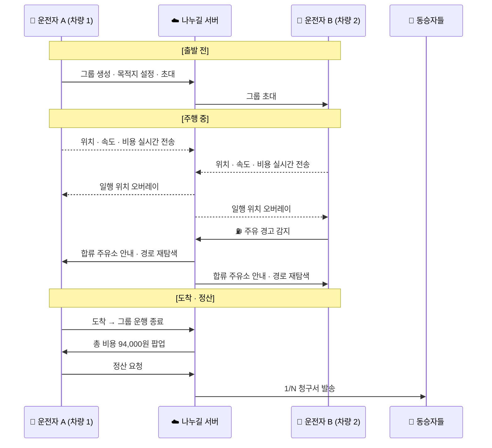
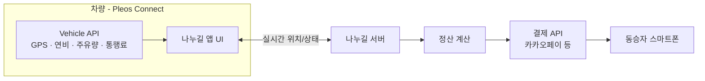

<div align="center">

# 🚗 나누길 (Nanugil)

**같이 달리고, 똑같이 나누는 그룹 주행 앱**

그룹 주행 중 차량끼리 실시간 위치를 공유하고,<br/>
전체 이동 비용을 탑승 인원수로 자동 1/N 정산하는 **Pleos Connect** 차량 앱입니다.

`현대자동차그룹 차량용 앱 개발 공모전 2026 출품작`

</div>

---

## 📑 목차

1. [프로젝트 소개](#-프로젝트-소개)
2. [기획 배경](#-기획-배경)
3. [주요 기능](#-주요-기능)
4. [사용 시나리오](#-사용-시나리오)
5. [기술 스택](#-기술-스택)
6. [시스템 구조](#-시스템-구조)
7. [프로젝트 구조](#-프로젝트-구조)
8. [시작하기](#-시작하기)
9. [개발 현황 / 로드맵](#-개발-현황--로드맵)
10. [문서](#-문서)
11. [협업 규칙](#-협업-규칙)
12. [팀](#-팀)

---

## 💡 프로젝트 소개

| 항목 | 내용 |
| --- | --- |
| 앱 이름 | 나누길 (Nanugil) |
| 플랫폼 | Pleos Connect (차량 인포테인먼트) |
| 한 줄 소개 | 그룹 주행 실시간 위치 공유 + 주행 데이터 기반 자동 1/N 정산 |
| 타깃 | 대학 MT, 동호회, 가족 여행 등 여러 대의 차량으로 함께 움직이는 그룹 |
| 시연 영상 | _추가 예정_ |
| APK | _추가 예정 ([Releases](../../releases))_ |

---

## 🔍 기획 배경

| 불편한 순간 | 현재 상황 |
| --- | --- |
| **다인원·다차량 정산** | 6명 이상이 여러 대에 나눠 타면 주유비·통행료를 차량별로 따로 결제하고, 여행 후 일일이 모아 1/N 계산·송금 요청을 해야 합니다. |
| **실시간 주행 정보 부재** | 일행 차량 위치를 알려면 운전 중 스마트폰으로 연락해야 해 위험하고 불편합니다. |
| **운전자의 정산 부담** | 차량을 제공하는 운전자가 유류비 청구에 심리적 부담을 느끼고, 비용이 고스란히 운전자 몫이 되기 쉽습니다. |

---

## ✨ 주요 기능

### 1. 커스텀 그룹 드라이브 모드
모임 이름으로 그룹 방을 만들면 일행 차량의 **실시간 위치 · 현재 속도 · 도착 예정 시간**이 모임 로고와 함께 내비게이션 화면에 오버레이됩니다. 전화나 메시지 없이도 그룹 전체의 주행 흐름을 한눈에 볼 수 있습니다.

### 2. 차량 상태 기반 스마트 합류점 추천
일행 중 한 차량의 **주유 잔량 / EV 배터리**가 기준 이하로 떨어지면, 그룹 전체 경로 위의 최적 주유소·휴게소를 자동 제안하고 모든 차량의 경로를 함께 바꿉니다.

### 3. 주행 데이터 기반 자동 정산
**누적 주행 거리 · 평균 연비 · 실시간 유가 · 하이패스 통행료**를 차량 API로 수집해 이동 비용을 계산하고, 탑승 인원수로 나눈 뒤 동승자 스마트폰으로 정산 요청을 보냅니다. (카카오페이 등 연동)

### 4. 차량 인포테인먼트 제어
그룹 생성, 정산 현황 확인, 알림 발송까지 **스마트폰 없이 차량 디스플레이만으로** 처리합니다.

---

## 🗺 사용 시나리오

> **'2026 신소재공학과 MT'** — 차량 2대, 가평 펜션행



| 차량 | 통행료 | 주유비 | 소계 |
| --- | ---: | ---: | ---: |
| 차량 1 | 8,000원 | 23,000원 | 31,000원 |
| 차량 2 | 8,000원 | 55,000원 | 63,000원 |
| **합계** | | | **94,000원 → 탑승 인원수로 1/N** |

---

## 🛠 기술 스택

> 개발이 진행되면서 확정되는 대로 갱신합니다.

| 분야 | 기술 |
| --- | --- |
| 차량 앱 | Kotlin · Android (Pleos Connect SDK) |
| 차량 데이터 | Pleos Connect Vehicle API (GPS, 연비, 주유량/배터리, 통행료) |
| 실시간 통신 | _TBD_ |
| 백엔드 | _TBD_ |
| 결제 연동 | 카카오페이 등 핀테크 오픈 API |
| 협업 | GitHub · GitHub Issues/PR |

---

## 🏗 시스템 구조



---

## 📁 프로젝트 구조

```
nanugil-android/
├── app/                      # Android 앱 모듈 (추가 예정)
├── docs/
│   ├── troubleshooting/      # 트러블슈팅 기록
│   └── decisions/            # 기술 의사결정 기록 (ADR)
└── README.md
```

---

## 🚀 시작하기

> 앱 모듈이 추가되면 빌드 방법을 채웁니다.

```bash
git clone https://github.com/Nanugil/nanugil-android.git
cd nanugil-android
# ./gradlew assembleDebug
```

**요구 사항**
- Android Studio (최신 안정 버전)
- Pleos Connect SDK / 에뮬레이터 — _설치 방법 추가 예정_

---

## 📌 개발 현황 / 로드맵

| 단계 | 내용 | 상태 |
| --- | --- | :---: |
| 기획 | 기획서 작성 · 공모전 접수 | ✅ |
| 환경 구축 | 저장소 · Pleos Connect 개발 환경 | 🔄 |
| 그룹 드라이브 | 그룹 생성/초대 · 실시간 위치 오버레이 | ⬜ |
| 스마트 합류점 | 주유량/배터리 감지 · 합류지 추천 · 경로 변경 | ⬜ |
| 자동 정산 | 비용 산출 · 1/N 분할 · 정산 요청 발송 | ⬜ |
| 제출 | 시연 영상 · APK · 최종 문서 정리 | ⬜ |

**향후 확장:** 카셰어링/렌터카 비용 분할 · EV 충전 요금 분할 · 식비 등 여행 경비를 합친 종합 모빌리티 가계부

---

## 📚 문서

개발하면서 겪은 문제와 결정을 기록합니다. 새 문서는 각 폴더의 `_template.md`를 복사해 `NNN-제목.md`로 저장하고, 아래 표에 한 줄 추가합니다.

### 🧯 트러블슈팅 — [`docs/troubleshooting`](docs/troubleshooting)
| # | 제목 | 분류 | 날짜 |
| --- | --- | --- | --- |
| - | _아직 없음_ | | |

### 🧭 기술 의사결정 (ADR) — [`docs/decisions`](docs/decisions)
| # | 제목 | 상태 | 날짜 |
| --- | --- | --- | --- |
| - | _아직 없음_ | | |

---

## 🤝 협업 규칙

**브랜치**
- `main` — 제출 가능한 안정 상태
- `develop` — 통합 브랜치
- `feat/<기능>`, `fix/<버그>`, `docs/<문서>` — 작업 브랜치

**커밋 메시지**
```
<type>: <요약>

feat     새 기능
fix      버그 수정
docs     문서
refactor 리팩터링
chore    빌드/설정 등 기타
```

---

## 👥 팀

> 공모전 규정에 따라 실명·연락처는 기재하지 않고 역할과 GitHub 계정만 표기합니다.

| 역할 | GitHub |
| --- | --- |
| _역할_ | _@계정_ |
