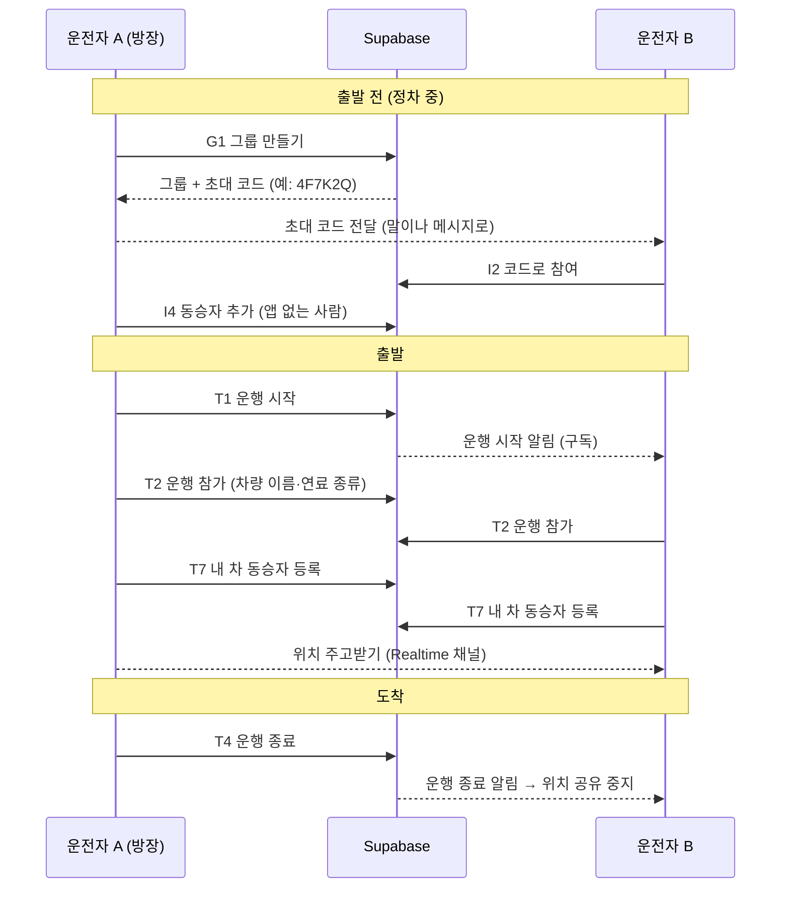
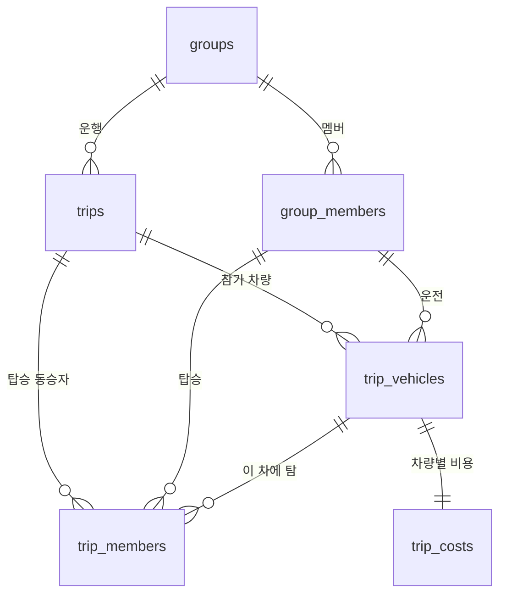

# 그룹·초대·운행 API 목록 (초안)

- **날짜:** 2026-11-07 (2026-11-08 PM 의견, 2026-11-10 팀장 보안 의견 반영)
- **상태:** 초안 — PM 합의 완료, 팀장 보안 의견 반영
- **작성:** 서버·실시간 통신 담당
- **근거:** [ADR-001 백엔드·실시간 통신 기술 선택](decisions/001-backend-realtime.md) — Supabase

## 이 문서의 목적

그룹을 만들고, 일행을 초대하고, 운행을 시작·종료하는 데 필요한 API를 한 곳에 모은다.
각 API가 **어떤 데이터를 읽고 쓰는지** 적어 두었고, PM과 합의해 이 문서의 [데이터 모델](#데이터-모델-공통-모델) 섹션을 **공통 데이터 모델**로 쓴다.

**이 문서에서 다루지 않는 것**

| 내용 | 담당 | 비고 |
| --- | --- | --- |
| 차량 상태 값 (연료·속도 등) 읽기, 비용·정산 계산 | 차량 데이터·정산 담당 | `trip_costs` 필드는 정산 담당과 확정한다. 정산 흐름은 [vehicle-api-research.md](vehicle-api-research.md) |
| 지도 표시, 합류점 추천 | 지도·그룹 드라이브 담당 | 위치 메시지 형식은 아래 [실시간](#4-실시간-위치-연결)에서 맞출 항목만 적는다 |
| 오피넷 유가 서버 호출 | 서버·실시간 통신 담당 | 별도 문서로 다룬다 |

## 한눈에 보기

## 기본 규칙

- **로그인:** 차량 앱은 처음 실행할 때 Supabase **익명 로그인**으로 사용자 ID를 받는다. 이메일·비밀번호 입력 없이 시작할 수 있어 차량 화면에 맞다. 계정 연결(카카오 로그인 등)은 필요해지면 추가한다.
- **구현 방식:** **읽기**는 Supabase 기본 API(테이블 직접 조회)로 하고, **쓰기(INSERT·UPDATE·DELETE)는 모두 RPC**(Postgres 함수)로만 한다. 별도 서버 코드는 두지 않는다.
- **권한:** 아래 [보안 규칙](#보안-규칙)을 따른다.
- **주행 중 입력 금지:** 그룹 만들기, 코드 입력처럼 글자를 넣는 API는 정차 중 화면에서만 부른다 (UX Restrictions, 팀장 담당).

### 보안 규칙

**1. 테이블 (RLS)**
- 모든 테이블에 RLS를 건다.
- **읽기(SELECT):** 같은 그룹 멤버만 읽을 수 있다.
- **쓰기(INSERT·UPDATE·DELETE):** 쓰기 정책을 만들지 않아 테이블 직접 쓰기를 막는다 (RLS가 켜진 테이블은 정책이 없으면 거부된다). `anon`·`authenticated` 역할의 테이블 쓰기 권한도 회수한다.
- 이유: 쓰기를 막지 않으면 `group_members`에 직접 INSERT해서 초대 코드 없이 그룹에 들어오거나, `groups`의 `owner_id`·`invite_code`를 마음대로 바꿀 수 있다.

**2. RPC**
- `SECURITY DEFINER`로 만들고 `search_path`를 고정한다 (`set search_path = ''`, 테이블은 `public.groups`처럼 스키마 이름까지 쓴다).
- 호출한 사람은 입력값이 아니라 **`auth.uid()`로 확인**한다. 사용자 ID나 "내 멤버 ID"를 입력으로 받아 믿지 않는다.
- 실행 권한은 로그인한 사용자(`authenticated`, 익명 로그인 포함)에게만 주고 `public`·`anon`에서는 회수한다.
- RPC별 검사:

| RPC | 호출한 사람 검사 (`auth.uid()` 기준) | 입력값 검사 |
| --- | --- | --- |
| `create_group` (G1) | 로그인 | 이름·목적지 필수 |
| `update_group` (G4) | 방장 | 바꿀 수 있는 값은 **이름·로고·목적지만**. `owner_id`·`invite_code` 등은 입력으로 받지 않는다 |
| `leave_group` (G5) | 본인, 또는 방장이 남을 뺄 때 | 대상이 같은 그룹 멤버 |
| `reset_invite_code` (I1) | 방장 | — |
| `join_group` (I2) | 로그인, 시도 횟수 (아래 3번) | 코드가 있고 만료되지 않음, 이미 멤버가 아님 |
| `preview_invite` (I3) | 로그인, 시도 횟수 (아래 3번) | 코드가 있고 만료되지 않음 |
| `add_passenger` (I4) | 그 그룹의 `DRIVER` | 이름 필수 |
| `start_trip` (T1), `end_trip` (T4) | 방장 | 시작: 진행 중 운행 없음 / 종료: 운행이 `ACTIVE` |
| `join_trip` (T2) | 그 그룹의 `DRIVER`. 운전자 자리는 **호출한 본인**으로 채운다 | 운행이 `ACTIVE`, 연료 종류가 정해진 값 중 하나 |
| `mark_arrived` (T6) | 그 운행에 참가한 운전자 본인 | 운행이 `ACTIVE` |
| `set_trip_passengers` (T7) | 그 운행에 참가한 운전자 본인. 운전자 자리(`vehicle_driver_member_id`)는 입력이 아니라 **호출한 본인**으로 채운다 | 각 `member_id`가 **같은 그룹의 `PASSENGER`**인지, 다른 차에 이미 타지 않았는지, 운행이 `ACTIVE`인지 |

**3. 초대 코드**
- 32종 문자 × 6자리 ≈ 10억 7천만 가지다. 시도 횟수 제한도 만료도 없으면 계속 넣어 보는 방식으로 뚫릴 수 있다. `preview_invite`는 참여 전에 그룹 이름과 인원을 알려 주므로 이런 시도에 쓰기 좋다.
- **시도 횟수 제한:** `join_group`과 `preview_invite`를 합쳐 사용자별로 최근 10분 동안 실패가 5회면 거절한다 (`TOO_MANY_ATTEMPTS`, 숫자는 임시값). 시도 기록은 `invite_attempts` 테이블에 남긴다.
- **만료 (MVP):** `groups.invite_code_expires_at`. 발급·재발급 후 24시간(임시값)이 지나면 쓸 수 없다. 만료된 코드도 없는 코드와 같은 오류(`INVALID_CODE`)를 돌려줘서, 그런 코드가 있었는지 알려 주지 않는다.
- **익명 가입 속도 제한:** Supabase 대시보드 Authentication → Rate Limits에서 익명 가입 제한을 켠다. 익명 계정을 계속 새로 만들어 사용자별 시도 제한을 피하는 것을 막는다.

**4. 실시간 채널**
- Supabase Broadcast는 기본이 공개 채널이라 테이블 RLS가 걸리지 않는다. 앱에 들어 있는 anon key와 채널 이름 `trip:{운행 ID}`만 알면 그룹 밖 사람도 위치를 받아 보고 가짜 위치를 보낼 수 있다.
- 채널은 **private 채널**(`private: true`)로 연다.
- `realtime.messages`에 RLS를 건다. **읽기(SELECT)와 보내기(INSERT) 모두** 채널 이름의 운행이 `ACTIVE`이고, 호출한 사람이 그 운행의 `trip_vehicles`에 있는 운전자일 때만 허용한다. Broadcast와 Presence 모두 이 규칙을 따른다.
- 운행이 끝나면(`ENDED`) 이 규칙에 걸려 채널을 더 쓸 수 없다.

**5. 알려진 한계**
- 위치 메시지의 `carId`는 보내는 쪽이 직접 넣는 값이라, 같은 운행에 참가한 멤버끼리는 다른 차인 척 보낼 수 있다. 시연에서는 넘어간다.

## API 목록

**표 읽는 법**
- **방식:** `테이블` = Supabase 기본 API로 테이블 직접 조회 (읽기만) / `RPC` = Postgres 함수 호출 / `구독` = Realtime
- **누가:** `방장` = `groups.owner_id`에 해당하는 사람 (방장도 운전자다) / `멤버` = 그룹에 속한 사람 / `운전자` = 차량 앱으로 참여한 멤버 (`role = DRIVER`)
- **MVP:** ● = 시연에 꼭 필요 / ○ = 시간 남으면

### 1. 그룹

| ID | 기능 | 방식 | 누가 | 입력 | 결과 | 쓰는 화면 | MVP |
| --- | --- | --- | --- | --- | --- | --- | :---: |
| G1 | 그룹 만들기 | RPC `create_group` | 로그인한 사용자 | 그룹 이름, 로고(선택, 기본 로고 중 고르기), 목적지 이름·좌표, 내 표시 이름 | 그룹, 초대 코드 | 그룹 만들기 | ● |
| G2 | 내 그룹 목록 | 테이블 `groups` | 멤버 | 없음 | 내가 속한 그룹 목록 (진행 중 운행 여부 포함) | 홈 | ● |
| G3 | 그룹 상세 | 테이블 `groups` + `group_members` | 멤버 | 그룹 ID | 그룹 정보, 멤버 목록 | 그룹 만들기, 정산 요약 | ● |
| G4 | 그룹 정보 수정 | RPC `update_group` | 방장 | 그룹 ID, 바꿀 값 (이름·로고·목적지만) | 수정된 그룹 | 그룹 만들기 | ○ |
| G5 | 그룹 나가기 / 멤버 빼기 | RPC `leave_group` | 본인 / 방장 | 그룹 ID, (방장이면) 멤버 ID | 없음 | 그룹 만들기 | ○ |

G1은 그룹 생성, 방장을 첫 멤버(`DRIVER`)로 등록, 초대 코드 발급을 **한 번에** 처리해야 해서 RPC로 만든다. 방장 여부는 `role`이 아니라 `groups.owner_id`로 판단한다.

### 2. 초대

| ID | 기능 | 방식 | 누가 | 입력 | 결과 | 쓰는 화면 | MVP |
| --- | --- | --- | --- | --- | --- | --- | :---: |
| I1 | 초대 코드 다시 만들기 | RPC `reset_invite_code` | 방장 | 그룹 ID | 새 초대 코드와 만료 시각 (이전 코드는 무효) | 그룹 만들기 | ● |
| I2 | 코드로 참여하기 | RPC `join_group` | 로그인한 사용자 | 초대 코드, 내 표시 이름 | 참여한 그룹 (`DRIVER`로 등록) | 그룹 참여 | ● |
| I3 | 코드 미리보기 | RPC `preview_invite` | 로그인한 사용자 | 초대 코드 | 그룹 이름, 멤버 수 (참여 전 확인용) | 그룹 참여 | ○ |
| I4 | 동승자 추가 | RPC `add_passenger` | 운전자 | 그룹 ID, 동승자 이름 | 추가된 멤버 (`PASSENGER`) | 그룹 만들기 | ● |

- **초대 코드:** 6자리 영문 대문자+숫자 (헷갈리는 `0/O`, `1/I` 제외). 차량 화면에서 입력하기 쉽고 말로 전하기도 쉽다. 발급 후 24시간이 지나면 만료되고, 참여·미리보기는 사용자별 시도 횟수 제한을 받는다 ([보안 규칙](#보안-규칙) 3번). 만료되면 방장이 I1로 다시 만든다. 그래서 I1을 시연 필수(●)로 올렸다.
- **동승자:** 동승자는 차량 앱을 쓰지 않으므로 로그인 계정 없이 이름만 있는 멤버로 그룹에 등록한다. **어느 차에 탔는지는 그룹이 아니라 운행마다** 기록한다 (T7). 동승자에게 청구서를 보낼 연락 수단은 정산 담당과 정한다.

### 3. 운행

운행(Trip)은 "그룹이 한 번 함께 이동하는 것"이다. 그룹 하나에 운행이 여러 번 있을 수 있고, **동시에 진행 중인 운행은 하나뿐**이다. 정산도 운행 단위로 한다.

| ID | 기능 | 방식 | 누가 | 입력 | 결과 | 쓰는 화면 | MVP |
| --- | --- | --- | --- | --- | --- | --- | :---: |
| T1 | 운행 시작 | RPC `start_trip` | 방장 | 그룹 ID, 목적지(선택, 없으면 그룹 목적지) | 운행 ID, 실시간 채널 이름 | 홈 / 그룹 만들기 | ● |
| T2 | 운행 참가 (내 차량 등록) | RPC `join_trip` | 운전자 | 운행 ID, 차량 표시 이름, 연료 종류 | 참가 처리 | 그룹 드라이브 진입 시 자동 | ● |
| T3 | 진행 중 운행 조회 | 테이블 `trips` + `trip_vehicles` + `trip_members` | 멤버 | 그룹 ID | 진행 중 운행, 참가 차량, 차량별 동승자 (없으면 비어 있음) | 홈, 앱 재시작 시 복귀 | ● |
| T4 | 운행 종료 (도착) | RPC `end_trip` | 방장 | 운행 ID | 종료 시각 | 그룹 드라이브 → 정산 요약 | ● |
| T5 | 운행 상태 바뀜 받기 | 구독 (Postgres Changes) `trips`, `trip_vehicles` | 멤버 | 그룹 ID | 시작·종료, 차량 도착 이벤트 | 홈, 그룹 드라이브 | ● |
| T6 | 내 차 도착 | RPC `mark_arrived` | 운전자 | 운행 ID | 도착 시각 | 그룹 드라이브 | ○ |
| T7 | 내 차 동승자 등록 | RPC `set_trip_passengers` | 운전자 | 운행 ID, 동승자 멤버 ID 목록 | 이 운행에서 내 차에 탄 동승자 | 그룹 드라이브 진입 전 (정차 중) | ● |

- **T1:** 진행 중 운행이 이미 있으면 거절한다 (DB 제약으로 막음). 목적지는 운행마다 따로 저장한다. 같은 그룹이 가는 길과 오는 길을 따로 운행하면 목적지가 다르기 때문이다. 입력이 없으면 그룹 목적지를 복사한다.
- **T2:** 운전자마다 "이 운행에 내 차가 참여한다"를 기록한다. 차량 표시 이름(지도 마커·정산 화면용)과 연료 종류(주유소·충전소 구분, 유가 선택용)를 함께 보낸다. 연료 종류는 차량 API `INFO_FUEL_TYPE`에서 읽는다 (차량 데이터·정산 담당 조사 문서). 차량별 비용(`trip_costs`)은 이 기록을 기준으로 붙는다.
- **T6:** 앞차가 먼저 도착하고 뒤차는 아직 오는 중일 수 있다. 차량마다 도착 시각을 남겨 "누가 도착했나"를 보여 준다. 운행 종료(T4)는 여전히 방장이 누른다.
- **T7:** 가는 길 8명, 오는 길 6명처럼 운행마다 인원과 탑승 차량이 바뀔 수 있다. 운전자가 이번 운행에서 자기 차에 탄 동승자를 고른다. 동승자 한 명은 한 운행에서 한 차에만 탈 수 있다. 같은 목록을 다시 보내면 덮어쓴다. 운전자 자리는 입력으로 받지 않고 호출한 본인으로 채우며, 고른 사람이 모두 같은 그룹의 `PASSENGER`인지 검사한다 ([보안 규칙](#보안-규칙) 2번).
- **1/N의 N:** 운행 인원 = 이 운행의 운전자 수(`trip_vehicles`) + 동승자 수(`trip_members`).
- **T1·T4를 방장만 할 수 있게 할지**, 운전자 누구나 할 수 있게 할지는 합의가 필요하다 (아래 [합의할 것](#합의할-것)).

### 4. 실시간 위치 연결

위치는 DB에 저장하지 않고 Realtime Broadcast로만 전달한다 (ADR-001).

| ID | 기능 | 방식 | 누가 | 내용 |
| --- | --- | --- | --- | --- |
| R1 | 위치 채널 들어가기 | 구독 (Broadcast, **private 채널**) | 운행 참가 운전자 | 채널 이름 `trip:{운행 ID}`, T1 결과로 받음. `realtime.messages` RLS로 이 운행의 운전자만 읽고 보낼 수 있다 ([보안 규칙](#보안-규칙) 4번) |
| R2 | 내 차 상태 보내기 | Broadcast 전송 | 운전자 | 3초 간격, 이벤트 이름 `car_state`. 정차 중에는 보내지 않고, 정차로 바뀔 때 한 번만 보낸다 (ADR-001) |
| R3 | 일행 차량 상태 받기 | Broadcast 수신 | 운전자 | R2와 같은 형식 |
| R4 | 접속 상태 | 구독 (Presence) | 운전자 | 채널에 붙어 있는 차량 목록. 끊긴 차량 표시용 |

지도 담당의 `GroupLocationRepository.observeGroup(groupId)`가 R1~R4를 감싼 실제 구현으로 바뀐다. `groupId`로 T3(진행 중 운행)를 찾아 채널에 들어가는 방식이다.

R2 메시지는 지도 담당의 `CarState`에 맞췄다. `carId`, 좌표, `speedKmh`, `etaMinutes`, `fuelPercent`가 `CarState`와 맞는 것을 PM이 확인했다. `driveStatus`, `sentAt`은 추가 제안이다.

| 필드 | 형식 | 비고 |
| --- | --- | --- |
| `carId` | 문자열 | 운전자 멤버 ID 사용 제안 |
| `lat`, `lng` | 실수 | WGS84 |
| `speedKmh` | 정수 | |
| `etaMinutes` | 정수 | 보내는 쪽 계산인지 받는 쪽 계산인지 합의 필요 |
| `fuelPercent` | 정수 0~100 | 연료 또는 배터리. 값 출처는 차량 데이터 담당 |
| `driveStatus` | `DRIVING` / `STOPPED` / `REST_AREA` | 주행·정차·휴게소 (README "상태 변화 표시"). 추가 제안. 판정 주체는 합의 필요 |
| `sentAt` | 시각 | 순서가 뒤바뀐 메시지 버리기용. 추가 제안 |

`driverName`과 차량 표시 이름은 매번 보내지 않고 G3 멤버 목록과 T3 참가 차량 목록에서 채운다. `isMe`는 받는 쪽에서 판단한다.

**한계:** `carId`는 보내는 쪽이 직접 넣는 값이라 같은 운행의 멤버끼리는 다른 차인 척할 수 있다. 시연에서는 넘어간다.

## 데이터 모델 (공통 모델)

PM과 합의해 이 섹션을 **공통 데이터 모델**로 쓴다 (합의할 것 1·4·7번). 아직 다른 담당과 맞출 필드는 표에 표시했다.

**groups** (Group)

| 필드 | 형식 | 설명 |
| --- | --- | --- |
| `id` | uuid | 기본 키 |
| `name` | 문자열 | 모임 이름 |
| `logo_url` | 문자열, 선택 | 모임 로고 |
| `destination_name` | 문자열 | 기본 목적지 이름 |
| `destination_lat`, `destination_lng` | 실수 | 기본 목적지 좌표 (WGS84) |
| `owner_id` | uuid | 방장의 로그인 사용자 ID. **방장 여부는 이 값으로 판단** |
| `invite_code` | 문자열 6자리, 고유 | |
| `invite_code_expires_at` | 시각 | 초대 코드 만료 시각. 발급·재발급 후 24시간(임시값) |
| `created_at` | 시각 | |

**group_members** (Member)

| 필드 | 형식 | 설명 |
| --- | --- | --- |
| `id` | uuid | 기본 키 |
| `group_id` | uuid | |
| `user_id` | uuid, 선택 | 로그인 사용자. 동승자는 비어 있음 |
| `display_name` | 문자열 | 화면에 보이는 이름 |
| `role` | `DRIVER` / `PASSENGER` | 방장도 `DRIVER`. 방장 여부는 `groups.owner_id` |
| `joined_at` | 시각 | |

탑승 차량은 그룹 단위로 저장하지 않는다. 운행마다 `trip_members`에 남긴다.

**trips** (Trip)

| 필드 | 형식 | 설명 |
| --- | --- | --- |
| `id` | uuid | 기본 키 |
| `group_id` | uuid | |
| `status` | `ACTIVE` / `ENDED` | 그룹당 `ACTIVE`는 하나만 |
| `started_by` | uuid | |
| `started_at`, `ended_at` | 시각 | |
| `destination_name`, `destination_lat`, `destination_lng` | 문자열, 실수 | 이번 운행의 목적지. 시작할 때 그룹 목적지를 복사 |

**trip_vehicles** (운행에 참가한 차량)

기본 키: (`trip_id`, `driver_member_id`)

| 필드 | 형식 | 설명 |
| --- | --- | --- |
| `trip_id` | uuid | |
| `driver_member_id` | uuid | 운전자 멤버 |
| `vehicle_label` | 문자열 | 차량 표시 이름 (예: "A차") |
| `fuel_type` | 아래 표 | 연료 종류. 차량 API `INFO_FUEL_TYPE`에서 읽음. **값 목록은 정산 담당과 확정** |
| `joined_at` | 시각 | |
| `arrived_at` | 시각, 선택 | 이 차가 도착한 시각 |

`fuel_type` 값은 오피넷 제품 코드와 바로 짝지을 수 있게 둔다 (코드는 [vehicle-api-research.md](vehicle-api-research.md) 기준).

| `fuel_type` | 오피넷 제품 코드 | 비고 |
| --- | --- | --- |
| `GASOLINE` | `B027` 휘발유 | |
| `PREMIUM_GASOLINE` | `B034` 고급휘발유 | `INFO_FUEL_TYPE`으로 구분이 안 되면 운전자가 고른다 |
| `DIESEL` | `D047` 경유 | |
| `LPG` | `K015` 자동차부탄 | |
| `EV` | 없음 | 충전 요금 출처 미정 (정산 담당) |

**trip_members** (운행별 동승자 탑승 기록)

기본 키: (`trip_id`, `member_id`) — 동승자 한 명은 한 운행에서 한 차에만 탄다.

| 필드 | 형식 | 설명 |
| --- | --- | --- |
| `trip_id` | uuid | |
| `member_id` | uuid | 동승자 멤버 (`role = PASSENGER`) |
| `vehicle_driver_member_id` | uuid | 탄 차의 운전자 멤버. (`trip_id`, `vehicle_driver_member_id`)가 `trip_vehicles`에 있어야 한다 |

**trip_costs** (TripCost, 차량별 비용)

`trip_vehicles`와 1:1이지만 쓰는 시점(도착 후)과 담당(정산)이 다르고, 유가 기준을 바꾸면 다시 계산하므로 별도 테이블로 둔다.
기본 키: (`trip_id`, `driver_member_id`)

아래 필드는 정산 담당 문서의 "정산 방식"에서 뽑은 **후보**다. **정산 담당과 확정한다.**

| 필드 후보 | 형식 | 정산 방식에서의 의미 |
| --- | --- | --- |
| `trip_id`, `driver_member_id` | uuid | `trip_vehicles`와 같은 키 |
| `start_fuel_l` | 실수 | 출발 시 연료량 |
| `refuel_l` | 실수 | 주유량 (여러 번이면 합계) |
| `end_fuel_l` | 실수 | 도착 시 연료량 |
| `used_fuel_l` | 실수 | 사용 연료 = 출발 + 주유 − 도착 |
| `fuel_calc_method` | `FUEL_LEVEL` / `PERCENT_CAPACITY` / `DISTANCE_EFFICIENCY` | 리터 계산 방식 (대체 순서 1~3) |
| `price_basis` | `NEAREST` / `CHEAPEST` | 유가 기준 (근처 / 근처 최저가) |
| `nearest_price`, `cheapest_price` | 정수 (원/L) | 두 가격을 함께 저장 |
| `applied_price` | 정수 (원/L) | 적용 유가 |
| `fuel_cost` | 정수 (원) | 주유비 추정 = 사용 연료 × 적용 유가 |
| `toll_estimated` | 정수 (원) | 통행료 예상액 (`tollFare`) |
| `toll_adjusted` | 정수 (원), 선택 | 운전자가 수정한 통행료 |
| `calculated_at` | 시각 | 마지막 계산 시각 (유가 기준을 바꾸면 갱신) |

**invite_attempts** (초대 코드 시도 기록, 보안용)

`join_group`·`preview_invite`의 시도 횟수 제한에 쓴다. 앱에서는 읽지 않고 RPC만 쓴다.

| 필드 | 형식 | 설명 |
| --- | --- | --- |
| `id` | uuid | 기본 키 |
| `user_id` | uuid | 시도한 사용자 (`auth.uid()`) |
| `attempted_at` | 시각 | |
| `succeeded` | 참/거짓 | 성공 여부. 최근 10분 실패 수를 셀 때 쓴다 |

VehicleState(차량 상태)는 DB에 저장하지 않고 실시간 메시지(R2)로만 주고받는다 (ADR-001).

## 오류 코드

RPC가 실패하면 아래 코드를 돌려준다. 앱은 코드에 맞는 짧은 안내 문구를 보여 준다.

| 코드 | 언제 | 안내 문구 예시 |
| --- | --- | --- |
| `NOT_MEMBER` | 내가 속하지 않은 그룹에 접근 | 이 그룹의 멤버가 아니에요 |
| `NOT_OWNER` | 방장만 할 수 있는 일을 다른 사람이 시도 | 방장만 할 수 있어요 |
| `NOT_DRIVER` | 운전자만 할 수 있는 일(I4, T2, T6, T7)을 다른 사람이 시도 | 운전자만 할 수 있어요 |
| `INVALID_CODE` | 없거나 만료된 초대 코드 (둘을 구분하지 않는다) | 초대 코드를 다시 확인해 주세요 |
| `TOO_MANY_ATTEMPTS` | 최근 10분 동안 초대 코드 실패 5회 | 잠시 후 다시 시도해 주세요 |
| `ALREADY_MEMBER` | 이미 참여한 그룹에 다시 참여 | 이미 참여한 그룹이에요 |
| `TRIP_ALREADY_ACTIVE` | 진행 중 운행이 있는데 또 시작 | 이미 운행 중이에요 |
| `TRIP_NOT_ACTIVE` | 끝난 운행에 참가·종료 시도 | 진행 중인 운행이 없어요 |
| `PASSENGER_TAKEN` | 이미 다른 차에 등록된 동승자를 T7로 등록 | 다른 차에 이미 탄 동승자예요 |
| `INVALID_PASSENGER` | T7에서 같은 그룹의 `PASSENGER`가 아닌 사람을 등록 | 이 그룹의 동승자가 아니에요 |

## 합의할 것

| # | 질문 | 상대 | 상태 |
| --- | --- | --- | --- |
| 1 | Group·Member 필드, Trip·TripVehicle 추가 | PM | ✅ 합의 — trips·trip_vehicles 추가, `role`에서 OWNER 제거(방장은 `owner_id`), `rides_with` 대신 `trip_members` |
| 2 | 운행 시작·종료를 방장만 할지, 운전자 누구나 할지 | 팀장 | 제안: 시연은 방장만 (단순함) |
| 3 | 동승자에게 청구서를 보낼 연락 수단 (전화번호, 카카오 ID 등)을 멤버에 저장할지 | 차량 데이터·정산 담당 | 제안: 정산 담당 결정을 따름. 저장한다면 방장·본인만 보이게 |
| 4 | TripCost 위치 | PM, 차량 데이터·정산 담당 | ✅ 합의 — 별도 테이블 `trip_costs`. 필드는 10번 |
| 5 | 위치 메시지 필드와 `etaMinutes` 계산 위치 | 지도·그룹 드라이브 담당 | `CarState` 필드 일치 확인(PM). ETA 계산 위치는 남음 — 제안: 보내는 쪽이 계산 |
| 6 | 그룹 인원·차량 수 상한 | 팀장 | 제안: 차량 5대, 인원 20명 |
| 7 | 차량 표시 이름·연료 종류 위치 | PM, 차량 데이터·정산 담당 | ✅ 합의 — `trip_vehicles`에 저장 |
| 8 | 주행 상태(`driveStatus`)를 누가 판정할지 | 지도·그룹 드라이브 담당, 차량 데이터·정산 담당 | 제안: 보내는 쪽 앱이 판정해서 R2에 실음 |
| 9 | 모임 로고를 사진 업로드로 할지, 기본 로고 중 고르기로 할지 | 팀장 | 제안: 시연은 기본 로고 고르기 |
| 10 | `trip_costs` 필드 확정 | 차량 데이터·정산 담당 | 위 후보 표 기준으로 확정 |
| 11 | `fuel_type` 값 목록과 오피넷 제품 코드 짝 | 차량 데이터·정산 담당 | 위 짝 표 기준으로 확정 |
| 12 | 초대 코드 시도 제한(10분 동안 실패 5회)과 만료(24시간) 값 | 팀장 | 제안: 위 임시값으로 시작 |

## 다음 단계

1. 남은 합의가 끝나면 이 문서를 확정본으로 고친다.
2. 확정된 모델로 Supabase 테이블·RLS·RPC SQL을 `supabase/` 폴더에 만든다.
3. 앱에 `supabase-kt`를 붙이고 `GroupLocationRepository` 실제 구현을 만든다.

**나중에 다룰 데이터 (메모)**
- **합류점 제안 기록 (4주차):** 제안한 장소·좌표·승인 상태. ADR-001에서 "놓치면 안 되는 알림은 DB에 남긴다"고 정한 대표 사례다. 추천 로직은 지도·그룹 드라이브 담당, 저장과 전달은 서버·실시간 통신 담당. 별도 문서로 정리한다.
## 검토 기록

| 날짜 | 의견 | 반영 |
| --- | --- | --- |
| 2026-11-08 | PM: 큰 틀 동의. 이 문서의 데이터 모델을 공통 모델로 사용. `role`에서 OWNER 제거, 운행별 탑승 기록 필요(`rides_with` 제거), `trip_vehicles` 기본 키 명시, `trip_costs` 별도 테이블, 차량 이름·연료 종류는 `trip_vehicles`, `fuel_type`은 오피넷 코드와 짝, R2와 `CarState` 필드 일치 확인 | 데이터 모델을 공통 모델로 전환, `trip_members`·`trip_costs` 추가, T7 API·`NOT_DRIVER`·`PASSENGER_TAKEN` 오류 추가, 합의할 것 1·4·7 합의 처리, 10·11 추가 |
| 2026-11-10 | PM: 합의 완료 | 상태 줄 갱신 |
| 2026-11-10 | 팀장: 보안 점검. ① 초대 코드 무차별 대입 위험 → 시도 횟수 제한, 만료를 MVP에, 익명 가입 속도 제한 ② Broadcast 공개 채널 → private 채널 + `realtime.messages` RLS, `carId` 위장은 한계로 기록 ③ 쓰기 규칙 없음 → 쓰기는 RPC로만, G4 수정 열 제한, `SECURITY DEFINER`·`search_path` 고정·`auth.uid()` 확인, T7 입력 검사 | "보안 규칙" 섹션 신설(테이블·RPC·초대 코드·실시간 채널·한계), G4를 RPC `update_group`으로, I1 시연 필수로, `invite_code_expires_at`·`invite_attempts` 추가, `TOO_MANY_ATTEMPTS`·`INVALID_PASSENGER` 오류 추가, R1 private 채널, 합의할 것 12 추가 |
