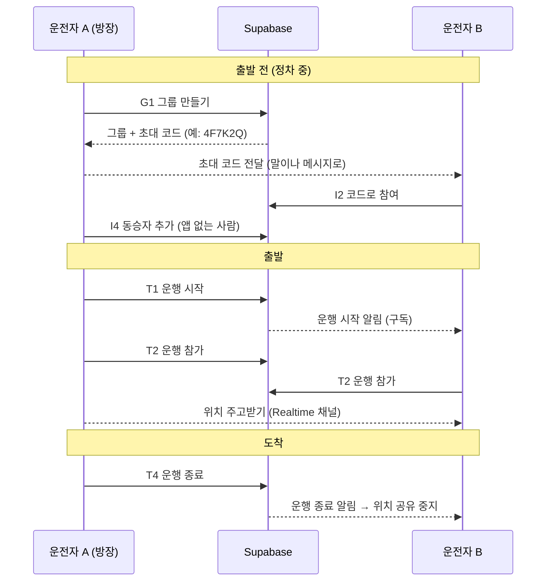
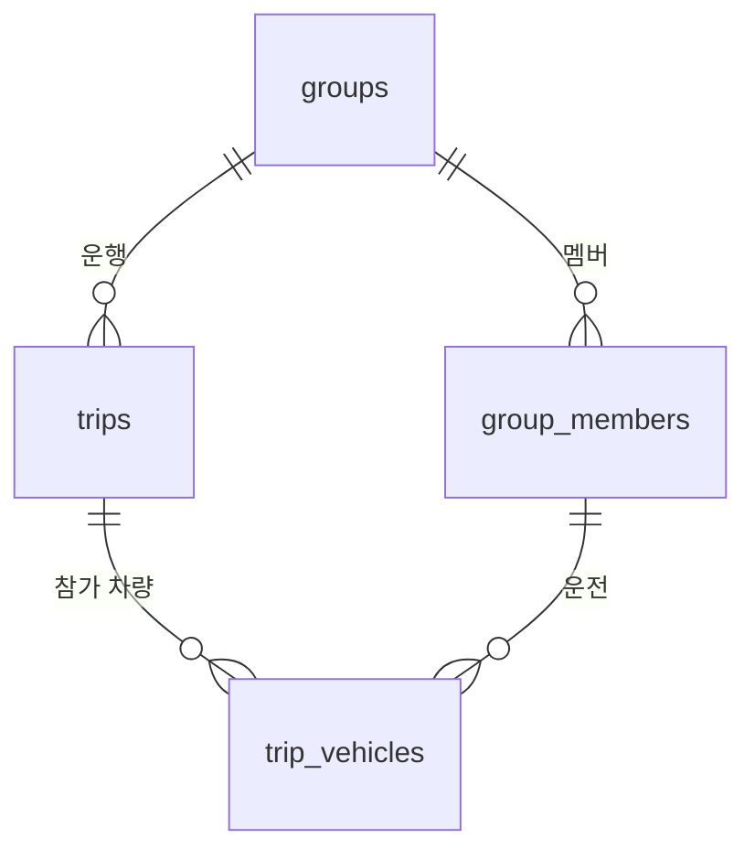

# 그룹·초대·운행 API 목록 (초안)

- **날짜:** 2026-11-07
- **상태:** 초안 (데이터 모델 합의용)
- **작성:** 서버·실시간 통신 담당
- **근거:** [ADR-001 백엔드·실시간 통신 기술 선택](decisions/001-backend-realtime.md) — Supabase

## 이 문서의 목적

그룹을 만들고, 일행을 초대하고, 운행을 시작·종료하는 데 필요한 API를 한 곳에 모은다.
각 API가 **어떤 데이터를 읽고 쓰는지** 적어 두었으니, 이 목록을 보고 공통 데이터 모델(PM 담당)의 필드를 함께 맞춘다.

**이 문서에서 다루지 않는 것**

| 내용 | 담당 | 비고 |
| --- | --- | --- |
| 공통 데이터 모델 확정 (Group·Member·VehicleState·TripCost) | PM | 아래 필드는 제안. 확정되면 이름과 형식을 그쪽에 맞춘다 |
| 차량 상태 값 (연료·속도 등) 읽기, 비용·정산 계산 | 차량 데이터·정산 담당 | 운행 종료 뒤 정산 흐름은 정산 담당 문서에서 다룬다 |
| 지도 표시, 합류점 추천 | 지도·그룹 드라이브 담당 | 위치 메시지 형식은 아래 [실시간](#4-실시간-위치-연결)에서 맞출 항목만 적는다 |
| 오피넷 유가 서버 호출 | 서버·실시간 통신 담당 | 별도 문서로 다룬다 |

## 한눈에 보기

## 기본 규칙

- **로그인:** 차량 앱은 처음 실행할 때 Supabase **익명 로그인**으로 사용자 ID를 받는다. 이메일·비밀번호 입력 없이 시작할 수 있어 차량 화면에 맞다. 계정 연결(카카오 로그인 등)은 필요해지면 추가한다.
- **구현 방식:** 한 테이블만 읽고 쓰는 일은 Supabase 기본 API(테이블 직접 조회)로 하고, 여러 테이블을 한 번에 바꾸거나 규칙 검사가 필요한 일은 **RPC**(Postgres 함수)로 만든다. 별도 서버 코드는 두지 않는다.
- **권한:** 모든 테이블에 RLS를 건다. 기본 규칙은 "같은 그룹 멤버만 읽을 수 있다"이다.
- **주행 중 입력 금지:** 그룹 만들기, 코드 입력처럼 글자를 넣는 API는 정차 중 화면에서만 부른다 (UX Restrictions, 팀장 담당).

## API 목록

**표 읽는 법**
- **방식:** `테이블` = Supabase 기본 API로 테이블 직접 조회·수정 / `RPC` = Postgres 함수 호출 / `구독` = Realtime
- **누가:** `방장` = 그룹 만든 사람 / `멤버` = 그룹에 속한 사람 / `운전자` = 차량 앱으로 참여한 멤버
- **MVP:** ● = 시연에 꼭 필요 / ○ = 시간 남으면

### 1. 그룹

| ID | 기능 | 방식 | 누가 | 입력 | 결과 | 쓰는 화면 | MVP |
| --- | --- | --- | --- | --- | --- | --- | :---: |
| G1 | 그룹 만들기 | RPC `create_group` | 로그인한 사용자 | 그룹 이름, 로고(선택), 목적지 이름·좌표, 내 표시 이름 | 그룹, 초대 코드 | 그룹 만들기 | ● |
| G2 | 내 그룹 목록 | 테이블 `groups` | 멤버 | 없음 | 내가 속한 그룹 목록 (진행 중 운행 여부 포함) | 홈 | ● |
| G3 | 그룹 상세 | 테이블 `groups` + `group_members` | 멤버 | 그룹 ID | 그룹 정보, 멤버 목록 | 그룹 만들기, 정산 요약 | ● |
| G4 | 그룹 정보 수정 | 테이블 `groups` | 방장 | 그룹 ID, 바꿀 값 (이름·로고·목적지) | 수정된 그룹 | 그룹 만들기 | ○ |
| G5 | 그룹 나가기 / 멤버 빼기 | RPC `leave_group` | 본인 / 방장 | 그룹 ID, (방장이면) 멤버 ID | 없음 | 그룹 만들기 | ○ |

G1은 그룹 생성, 방장을 첫 멤버로 등록, 초대 코드 발급을 **한 번에** 처리해야 해서 RPC로 만든다.

### 2. 초대

| ID | 기능 | 방식 | 누가 | 입력 | 결과 | 쓰는 화면 | MVP |
| --- | --- | --- | --- | --- | --- | --- | :---: |
| I1 | 초대 코드 다시 만들기 | RPC `reset_invite_code` | 방장 | 그룹 ID | 새 초대 코드 (이전 코드는 무효) | 그룹 만들기 | ○ |
| I2 | 코드로 참여하기 | RPC `join_group` | 로그인한 사용자 | 초대 코드, 내 표시 이름 | 참여한 그룹 | 그룹 참여 | ● |
| I3 | 코드 미리보기 | RPC `preview_invite` | 로그인한 사용자 | 초대 코드 | 그룹 이름, 멤버 수 (참여 전 확인용) | 그룹 참여 | ○ |
| I4 | 동승자 추가 | RPC `add_passenger` | 운전자 | 그룹 ID, 동승자 이름, 탈 차량(운전자 멤버 ID) | 추가된 멤버 | 그룹 만들기 | ● |

- **초대 코드:** 6자리 영문 대문자+숫자 (헷갈리는 `0/O`, `1/I` 제외). 차량 화면에서 입력하기 쉽고 말로 전하기도 쉽다.
- **동승자:** 동승자는 차량 앱을 쓰지 않으므로 로그인 계정 없이 이름만 있는 멤버로 등록한다. 정산 인원수에 들어가야 하기 때문이다. 동승자에게 청구서를 보낼 연락 수단은 정산 담당과 정한다.

### 3. 운행

운행(Trip)은 "그룹이 한 번 함께 이동하는 것"이다. 그룹 하나에 운행이 여러 번 있을 수 있고, **동시에 진행 중인 운행은 하나뿐**이다.

| ID | 기능 | 방식 | 누가 | 입력 | 결과 | 쓰는 화면 | MVP |
| --- | --- | --- | --- | --- | --- | --- | :---: |
| T1 | 운행 시작 | RPC `start_trip` | 방장 | 그룹 ID | 운행 ID, 실시간 채널 이름 | 홈 / 그룹 만들기 | ● |
| T2 | 운행 참가 (내 차량 등록) | RPC `join_trip` | 운전자 | 운행 ID | 참가 처리 | 그룹 드라이브 진입 시 자동 | ● |
| T3 | 진행 중 운행 조회 | 테이블 `trips` | 멤버 | 그룹 ID | 진행 중 운행 (없으면 비어 있음) | 홈, 앱 재시작 시 복귀 | ● |
| T4 | 운행 종료 (도착) | RPC `end_trip` | 방장 | 운행 ID | 종료 시각 | 그룹 드라이브 → 정산 요약 | ● |
| T5 | 운행 상태 바뀜 받기 | 구독 (Postgres Changes) `trips` | 멤버 | 그룹 ID | 시작·종료 이벤트 | 홈, 그룹 드라이브 | ● |

- **T1:** 진행 중 운행이 이미 있으면 거절한다 (DB 제약으로 막음).
- **T2:** 운전자마다 "이 운행에 내 차가 참여한다"를 기록한다. 차량별 비용(TripCost)은 이 기록을 기준으로 붙는다.
- **T4:** 종료되면 T5로 모든 차량에 알리고, 각 앱은 위치 전송을 멈추고 실시간 채널에서 나간다 ("위치는 운행 중에만 공유" 원칙). 정산 시작은 이 시점부터 정산 담당 흐름으로 넘어간다.
- **T1·T4를 방장만 할 수 있게 할지**, 운전자 누구나 할 수 있게 할지는 합의가 필요하다 (아래 [합의할 것](#합의할-것)).

### 4. 실시간 위치 연결

위치는 DB에 저장하지 않고 Realtime Broadcast로만 전달한다 (ADR-001).

| ID | 기능 | 방식 | 누가 | 내용 |
| --- | --- | --- | --- | --- |
| R1 | 위치 채널 들어가기 | 구독 (Broadcast) | 운행 참가 운전자 | 채널 이름 `trip:{운행 ID}`, T1 결과로 받음 |
| R2 | 내 차 상태 보내기 | Broadcast 전송 | 운전자 | 2~3초 간격, 이벤트 이름 `car_state` |
| R3 | 일행 차량 상태 받기 | Broadcast 수신 | 운전자 | R2와 같은 형식 |
| R4 | 접속 상태 | 구독 (Presence) | 운전자 | 채널에 붙어 있는 차량 목록. 끊긴 차량 표시용 |

지도 담당의 `GroupLocationRepository.observeGroup(groupId)`가 R1~R4를 감싼 실제 구현으로 바뀐다. `groupId`로 T3(진행 중 운행)를 찾아 채널에 들어가는 방식이다.

R2 메시지 초안은 지도 담당의 `CarState`에 맞췄다.

| 필드 | 형식 | 비고 |
| --- | --- | --- |
| `carId` | 문자열 | 운전자 멤버 ID 사용 제안 |
| `lat`, `lng` | 실수 | WGS84 |
| `speedKmh` | 정수 | |
| `etaMinutes` | 정수 | 보내는 쪽 계산인지 받는 쪽 계산인지 합의 필요 |
| `fuelPercent` | 정수 0~100 | 연료 또는 배터리. 값 출처는 차량 데이터 담당 |
| `sentAt` | 시각 | 순서가 뒤바뀐 메시지 버리기용 |

`driverName`은 매번 보내지 않고 G3 멤버 목록에서 채운다. `isMe`는 받는 쪽에서 판단한다.

## 데이터 모델 제안 (PM과 합의용)

위 API가 쓰는 최소 필드만 적었다. 이름과 형식은 PM의 공통 데이터 모델이 정해지면 그쪽을 따른다.

**groups** (공통 모델의 Group)

| 필드 | 형식 | 설명 |
| --- | --- | --- |
| `id` | uuid | |
| `name` | 문자열 | 모임 이름 |
| `logo_url` | 문자열, 선택 | 모임 로고 |
| `destination_name` | 문자열 | 목적지 이름 |
| `destination_lat`, `destination_lng` | 실수 | 목적지 좌표 (WGS84) |
| `owner_id` | uuid | 방장의 로그인 사용자 ID |
| `invite_code` | 문자열 6자리, 고유 | |
| `created_at` | 시각 | |

**group_members** (공통 모델의 Member)

| 필드 | 형식 | 설명 |
| --- | --- | --- |
| `id` | uuid | |
| `group_id` | uuid | |
| `user_id` | uuid, 선택 | 로그인 사용자. 동승자는 비어 있음 |
| `display_name` | 문자열 | 화면에 보이는 이름 |
| `role` | `OWNER` / `DRIVER` / `PASSENGER` | |
| `rides_with` | uuid, 선택 | 동승자가 탄 차의 운전자 멤버 ID |
| `joined_at` | 시각 | |

**trips** (공통 모델에 없음 — 추가 제안)

| 필드 | 형식 | 설명 |
| --- | --- | --- |
| `id` | uuid | |
| `group_id` | uuid | |
| `status` | `ACTIVE` / `ENDED` | 그룹당 `ACTIVE`는 하나만 |
| `started_by` | uuid | |
| `started_at`, `ended_at` | 시각 | |

**trip_vehicles** (공통 모델에 없음 — 추가 제안)

| 필드 | 형식 | 설명 |
| --- | --- | --- |
| `trip_id` | uuid | |
| `driver_member_id` | uuid | 운전자 멤버 |
| `joined_at` | 시각 | |

VehicleState(차량 상태)는 실시간 메시지(R2)로만 오가고 DB에는 저장하지 않는 것을 제안한다. TripCost(차량별 비용)의 위치와 필드는 정산 담당·PM과 정한다 (합의할 것 4번).

## 오류 코드

RPC가 실패하면 아래 코드를 돌려준다. 앱은 코드에 맞는 짧은 안내 문구를 보여 준다.

| 코드 | 언제 | 안내 문구 예시 |
| --- | --- | --- |
| `NOT_MEMBER` | 내가 속하지 않은 그룹에 접근 | 이 그룹의 멤버가 아니에요 |
| `NOT_OWNER` | 방장만 할 수 있는 일을 다른 사람이 시도 | 방장만 할 수 있어요 |
| `INVALID_CODE` | 없는 초대 코드 | 초대 코드를 다시 확인해 주세요 |
| `ALREADY_MEMBER` | 이미 참여한 그룹에 다시 참여 | 이미 참여한 그룹이에요 |
| `TRIP_ALREADY_ACTIVE` | 진행 중 운행이 있는데 또 시작 | 이미 운행 중이에요 |
| `TRIP_NOT_ACTIVE` | 끝난 운행에 참가·종료 시도 | 진행 중인 운행이 없어요 |

## 합의할 것

| # | 질문 | 상대 | 제안 |
| --- | --- | --- | --- |
| 1 | Group·Member 필드가 위 제안과 맞는지, Trip·TripVehicle을 공통 모델에 추가할지 | PM | 위 표대로 추가 |
| 2 | 운행 시작·종료를 방장만 할지, 운전자 누구나 할지 | 팀장 | 시연은 방장만 (단순함) |
| 3 | 동승자에게 청구서를 보낼 연락 수단 (전화번호, 카카오 ID 등)을 멤버에 저장할지 | 차량 데이터·정산 담당 | 정산 담당 결정을 따름. 저장한다면 방장·본인만 보이게 |
| 4 | TripCost를 `trip_vehicles`에 붙일지, 별도 테이블로 둘지 | 차량 데이터·정산 담당, PM | 별도 테이블 `trip_costs (trip_id, driver_member_id, …)` |
| 5 | 위치 메시지 필드와 `etaMinutes` 계산 위치 | 지도·그룹 드라이브 담당 | 보내는 쪽이 자기 ETA 계산 |
| 6 | 그룹 인원·차량 수 상한 | 팀장 | 차량 5대, 인원 20명 |

## 다음 단계

1. 위 합의가 끝나면 이 문서를 확정본으로 고친다.
2. 확정된 모델로 Supabase 테이블·RLS·RPC SQL을 `supabase/` 폴더에 만든다.
3. 앱에 `supabase-kt`를 붙이고 `GroupLocationRepository` 실제 구현을 만든다.
